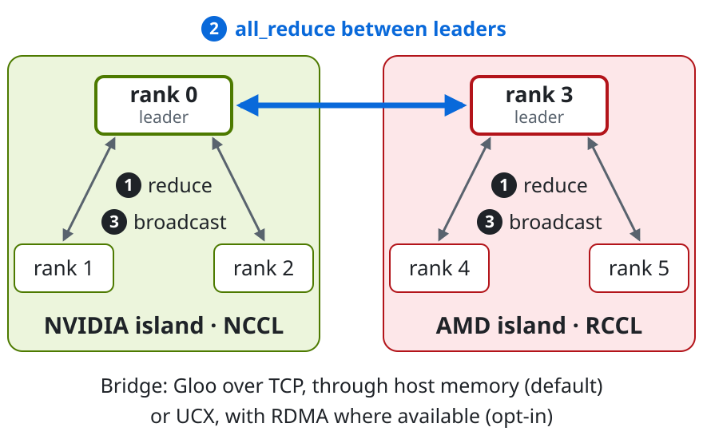
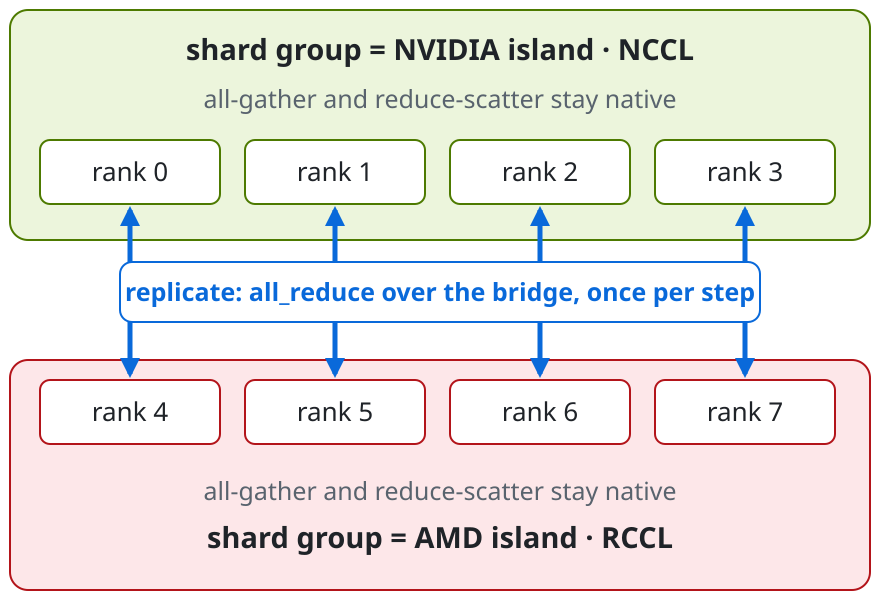

# gpubridge

**One PyTorch training job across NVIDIA and AMD GPUs: each vendor runs on its
native NCCL or RCCL, and a bridge joins them.**

[](https://github.com/DavidCzartoryski/gpubridge/actions/workflows/tests.yml)
[](LICENSE)
[](https://github.com/DavidCzartoryski/gpubridge/releases)

**Status:** alpha. Validated on CPU, in simulation and with CUDA and ROCm
builds of PyTorch joined in one job. On GPUs since 2026-10-14: single-vendor
runs on NVIDIA V100, T4, L40S, A100 and H200 and an AMD MI50, and mixed jobs of
one V100 and one MI50 (one GPU per vendor) over TCP. The
[CHANGELOG](CHANGELOG.md)'s header lists every GPU run, and
[docs/BENCHMARKS.md](docs/BENCHMARKS.md) what the bridge costs.

<picture>
  <source media="(prefers-color-scheme: dark)" srcset="docs/img/architecture-dark.svg">
  
</picture>

## Quickstart

```bash
# not on PyPI: install the release tag from GitHub
pip install "gpubridge @ git+https://github.com/DavidCzartoryski/gpubridge@v0.4.0-alpha"
```

As a `torch.distributed` backend, with plain DDP (FSDP2 and HSDP work too):

```python
import gpubridge  # registers the backend; on torch < 2.14, import it first
import torch.distributed as dist
from torch.nn.parallel import DistributedDataParallel

dist.init_process_group(backend="gpubridge")  # instead of "nccl"
model = DistributedDataParallel(model)
```

Or with gpubridge's own API (one or the other in a process, not both):

```python
topology = gpubridge.init()
gpubridge.all_reduce(grad)  # summed across NVIDIA and AMD ranks
```

Launch the same script on every node with `torchrun`; each process detects
its own vendor. No GPUs? See [Simulation mode](#simulation-mode-no-gpus-needed).

## Features

| Feature | Status |
| --- | --- |
| Collectives: `all_reduce`, `broadcast`, `all_gather_into_tensor`, `reduce_scatter_tensor`, `barrier` | tested on CPU · passed on a V100 + MI50, one GPU each, and in split tests (two processes on one NVIDIA or AMD GPU, labeled as two vendors) |
| Async collectives (`async_op=True`) and a DDP comm hook | tested on CPU · passed on a V100 + MI50; DDP with the hook trained there with torch 2.9.1+rocm6.3 on the MI50 |
| `torch.distributed` backend: DDP, FSDP2, HSDP through subgroups | experimental · tested on CPU · DDP and FSDP2 trained on a V100 + MI50 (torch 2.9.1+rocm6.3 on the MI50), FSDP2 bit for bit against a replay; HSDP passed there with torch 2.14.1 on the V100 (since #80) |
| Point-to-point through the backend: `send`, `recv`, `isend`, `irecv`, `batch_isend_irecv` | experimental · tested on CPU · passed on a V100 + MI50 and on a V100 split test (commit 1c7d107), through the Gloo link; not yet the UCX lanes or native GPU batches |
| Pipelined and sharded bridge policies | opt-in · tested on CPU · correct and benchmarked on a V100 + MI50 (one GPU each, so the sharded bridge had one link) |
| UCX bridge transport (RDMA where available) | opt-in · tested on CPU over TCP · not yet on GPU or RDMA |
| Multi-stream TCP bridge transport (Rust) | opt-in · tested on CPU over loopback TCP · not yet between two machines |
| bf16 / fp8 bridge compression with Triton kernels | opt-in · kernels match the CPU reference on V100, H200 and MI50 (on the MI50 with Triton 3.8.0; torch 2.9.1+rocm6.3's own Triton 3.5.1 can't compile them); benchmarked on a V100 + MI50 |
| GPU validation kit: Slurm job scripts, checks, benchmarks | every script runs end to end on CPU against a fake Slurm · run on Explorer: steps 01, 02, `amd`, 07, 08, the network checks and the training benchmarks; not the multi-GPU steps 03 to 06 |

[HARDWARE_VALIDATION.md](HARDWARE_VALIDATION.md) lists what each one still
needs from real GPUs.

## How it works

A PyTorch install is either a CUDA build or a ROCm build, so every process
belongs to exactly one vendor. gpubridge groups processes by vendor:

- **Island:** every rank of one vendor, in a process group on the native
  backend. That is NCCL on NVIDIA, and RCCL on AMD, which ROCm builds of
  PyTorch still call `"nccl"`.
- **Bridge:** a CPU link between one **leader** per island, where the leader
  is the island's lowest global rank. By default it is a Gloo process group;
  the transport can be swapped (see [Bridge transports](#bridge-transports)).

**`all_reduce`** uses reduce-bridge-broadcast (the diagram above):

1. `reduce` within each island onto its leader, on the native backend. Only
   the leader needs the island sum, and a reduce moves about half the bytes of
   an all_reduce.
2. Leaders copy the island sum to CPU and `all_reduce` it over the bridge.
3. Each leader copies the total back to its GPU and broadcasts it to its island.

**`broadcast(tensor, src)`** takes three hops: from `src` to the rest of its
island, from that island's leader over the bridge to the other leaders, then
from each leader to the rest of its island.

If the cluster has only one vendor there is no bridge, and every call goes
straight to the native collective.
These paths are the default [collective policies](#collective-policies).
Opt-in policies change how data travels (in chunks, or over several bridge
links at once), never what a collective computes, and `auto` never picks them.

### Initialization

`gpubridge.init()` does the following:

1. Creates the default process group on **Gloo** across all ranks. NCCL cannot
   span both vendors, so this CPU group handles discovery and `barrier`.
2. Each rank detects its vendor from `torch.version.hip` (AMD) or
   `torch.version.cuda` (NVIDIA), and runs `gpubridge.probe()`, which never
   raises: build, visible GPUs, and whether the NCCL and Gloo backends exist.
   Anything that would stop the rank (no vendor, no GPU, no NCCL/RCCL, or a
   `LOCAL_RANK` with no visible GPU behind it) is recorded as a problem instead
   of being raised on that rank alone. `torch.cuda.set_device` waits until
   discovery has passed, so a bad device index can't crash one rank and leave
   the rest waiting in rendezvous.
3. Every rank shares its vendor, probe, problems, hostname and chosen bridge
   transport with `all_gather_object`. If any rank reported a problem, or the
   ranks disagree on CPU versus GPU mode or on the bridge transport, `init()`
   raises the same error on every rank, listing every problem. Nobody is left
   waiting for a rank that already gave up.
4. Each rank computes the same islands, leaders and bridge from that shared
   map. If two ranks of one island would drive the same GPU (compared by UUID
   and PCI address), `init()` raises on every rank, since NCCL and RCCL refuse
   that. If a GPU reports neither (some ROCm builds), rank 0 warns that its
   island goes unchecked instead. Every rank calls `new_group` for every group
   in the same order, as `torch.distributed` requires, and the bridge
   transport is created the same way.

## Install

The [quickstart](#quickstart) installs a tagged release; `pip install
git+https://github.com/DavidCzartoryski/gpubridge` installs `main`. For
development, see [CONTRIBUTING.md](CONTRIBUTING.md).

On GPU nodes, install the CUDA or ROCm build of PyTorch first. gpubridge only
needs `torch>=2.8` (and numpy), so it leaves an existing 2.8 or newer install
alone. With an older one, pip would replace it with a default build, so
upgrade it first. Older releases can deadlock while tearing down Gloo groups,
which [pytorch/pytorch#154976](https://github.com/pytorch/pytorch/pull/154976)
fixed in 2.8. CI tests 2.8.0 on Python 3.10 and the newest release on 3.12.
Opt-in bridge compression runs Triton kernels on GPUs; PyTorch's CUDA and
ROCm builds for Linux bring Triton with them. Without it, compression falls
back to slower PyTorch code with the same results.

## Examples

- [`examples/all_reduce_torchrun.py`](examples/all_reduce_torchrun.py): the
  native API under `torchrun`, one script for every node.
- [`examples/train_synthetic.py`](examples/train_synthetic.py): a small model
  trained with DistributedDataParallel, its gradients synced through
  `gpubridge.ddp_comm_hook`. It reports samples/sec and checks that every
  rank ends with identical parameters
  (`GPUBRIDGE_VENDOR=nvidia torchrun --nproc-per-node=2 examples/train_synthetic.py`
  on CPU).
- [`examples/ddp_torch_backend.py`](examples/ddp_torch_backend.py) and
  [`examples/fsdp2_torch_backend.py`](examples/fsdp2_torch_backend.py): plain
  DDP and FSDP2 scripts on `backend="gpubridge"` (`--hsdp` for HSDP,
  `--verify` to check against a single process).
- [`examples/simulate_two_islands.py`](examples/simulate_two_islands.py): two
  NVIDIA and two AMD ranks on one CPU (below).

## Simulation mode (no GPUs needed)

Set `GPUBRIDGE_VENDOR=nvidia` or `GPUBRIDGE_VENDOR=amd` on a process to fake
its vendor. With the variable set:

- islands use Gloo instead of NCCL/RCCL, and
- tensors stay on CPU (`topology.device` is `cpu`).

Everything else is the code path used on real GPUs: discovery, leader
election, group creation, and reduce-bridge-broadcast. Set the variable on
every rank or on none; `init()` refuses a mix of CPU and GPU ranks.

`GPUBRIDGE_SIM_HOSTNAME` sets the machine name a simulated rank reports, so
processes on one machine can stand in for several nodes (for `node` split-test
mode, and for the multi-node job scripts' CPU tests). It is ignored on GPUs.

Run the four-rank demo (2 NVIDIA + 2 AMD):

```bash
python examples/simulate_two_islands.py
```

```
island nvidia ranks=[0, 1] leader=0
island amd    ranks=[2, 3] leader=2
bridge ranks=[0, 2]

rank 0 (nvidia, leader): [10.0, 10.0, 10.0, 10.0]
rank 1 (nvidia, member): [10.0, 10.0, 10.0, 10.0]
rank 2 (amd, leader): [10.0, 10.0, 10.0, 10.0]
rank 3 (amd, member): [10.0, 10.0, 10.0, 10.0]

expected 10.0 on every rank: all ranks match
```

Or act as two nodes of different vendors with `torchrun`, using two terminals.
The commands are in the docstring of `examples/all_reduce_torchrun.py`.

### CPU-only mode (real builds, no GPUs)

`GPUBRIDGE_CPU_ONLY=1` also runs on CPU with Gloo islands, but keeps the real
vendor detection: a CUDA build of PyTorch reports NVIDIA and a ROCm build
reports AMD, even on a machine with no GPU. This is how
[`scripts/mixed_build_rendezvous.sh`](scripts/mixed_build_rendezvous.sh) checks
that CUDA-build and ROCm-build processes can share one job. If both variables
are set, `GPUBRIDGE_VENDOR` wins. As with simulation mode, `init()` refuses a
job where some ranks run on CPU and others on GPUs.

### Split-test mode (test only)

`GPUBRIDGE_SPLIT_TEST=half|alternate|node` (`1` means `half`) labels some ranks
of a single-vendor job as the other vendor. They keep their real GPUs and real
NCCL/RCCL, so one NVIDIA (or AMD) cluster can run two islands and the bridge on
device tensors. Only NCCL talking to RCCL goes untested.

The environment variable is the only switch, and split runs can't pass for
mixed-vendor ones:

- every rank logs a `SplitTestWarning`;
- `Topology.split_test` and `Topology.run_kind` (`"split-test"`) mark the run;
- the GPU validation kit flags these runs in every JSON record and summary.

`node` mode splits by machine. In split-test mode only, ranks may share a GPU,
as long as they are in different islands; on one node, `half` with at most
twice as many ranks as GPUs always keeps them apart.

## API

The API follows `torch.distributed`, always on the world group.

| Function | Description |
| --- | --- |
| `init(init_method=None, *, rank=None, world_size=None, timeout=None, bridge="gloo", policy="auto") -> Topology` | Join the cluster and build the islands and bridge. Same arguments as `init_process_group`, plus the bridge transport (a registered name or a `BridgeTransport` subclass) and the [collective policy](#collective-policies) (`"auto"`, a registered name, or a `CollectivePolicy` subclass). Both must be the same on every rank. |
| `all_reduce(tensor, op=ReduceOp.SUM, *, async_op=False)` | In-place reduction across all ranks: `SUM`, `AVG`, `MAX` or `MIN`. `AVG` is a SUM divided by the world size, identically on every rank, so it needs a floating-point dtype. |
| `broadcast(tensor, src, *, async_op=False)` | In-place copy from global rank `src` to all ranks. |
| `all_gather_into_tensor(output, input, *, async_op=False)` | Every rank's `input`, back to back in global rank order, in `output` (`world_size` times as many elements). |
| `reduce_scatter_tensor(output, input, op=ReduceOp.SUM, *, async_op=False)` | Rank `r` gets slice `r` of the reduced `input` (`SUM` or `AVG`). |
| `ddp_comm_hook(state, bucket)` | A DistributedDataParallel communication hook that averages each gradient bucket with an async gpubridge `all_reduce`. See [DistributedDataParallel](#distributeddataparallel). |
| `barrier(*, async_op=False)` | Wait for all ranks. On GPUs, first waits for this rank's queued GPU work. |
| `destroy()` | Tear down every group `init` created. |
| `get_topology() -> Topology` | This rank's view of the cluster (see below). |
| `is_initialized() -> bool` | True between `init` and `destroy`. |
| `probe() -> Probe` | This process's build vendor, CUDA/HIP versions, visible GPU count, and NCCL/Gloo availability. Never raises; failed checks are listed in `Probe.errors`. Works before `init`. |
| `add_observer(observer)` / `remove_observer(observer)` | Start or stop sending this rank's collective records to a `CollectiveObserver` (see [Observing collectives](#observing-collectives)). |
| `in_flight() -> list[InFlight]` | The collective each thread of this rank is inside right now: `seq`, `op`, `policy`, current `phase`, `phases_done`, `thread`, `seconds`. A debugging aid for hangs, safe to call from any thread (see [Debugging a hang](#debugging-a-hang)). |

Every collective takes `async_op`. With `async_op=True` it returns a `Work`
(`wait()`, `is_completed()`, `exception()`, `get_future()`); see
[Async collectives](#async-collectives). `PRODUCT` is not supported yet:
NCCL/RCCL and Gloo still have to be shown to agree on it in every dtype.

Tensors must be contiguous and on `topology.device`: the rank's GPU, or CPU in
simulation mode. Their dtype must be one that both the island backend and Gloo
support (`gpubridge.collectives.SUPPORTED_DTYPES`): float16, bfloat16, float32,
float64, int8, uint8, int32 or int64. Anything else is rejected on every rank
before any communication. `bool` is excluded because a SUM of bools is a
logical OR on both backends.

`Topology` exposes `rank`, `world_size`, `vendor` (the island label),
`detected_vendor`, `run_kind` (`gpu-mixed`, `gpu-single-vendor`, `split-test` or
`cpu`), `split_test`, `device`, `simulated`, `island`, `is_leader`, `layout`
(every island, its ranks and leader), `peers`
(each rank's vendor, hostname, bridge transport and `probe` results),
`island_group`, `bridge` (the transport linking island leaders), and `policy`
/ `policy_name` (the active collective policy). `bridge_group` is the bridge's
process group when the transport has one, as the default Gloo transport does.

### Collective policies

A policy decides how a collective travels: which process groups carry the
data, and in which order. It never changes what the collective computes,
unless you turn on bridge compression (below).
Every rank must use the same policy; `init()` fails on every rank otherwise,
or if the policy doesn't fit the cluster.

Every built-in policy carries every collective and reduction above. MAX and
MIN over the bridge also need the bridge transport to list them in
`reduce_ops`, as the default Gloo transport does. A custom policy offers
`all_gather_into_tensor` and `reduce_scatter_tensor` only if it overrides them;
otherwise those calls fail on every rank before any communication, naming the
policies that do.

| Policy | Applies to | What it does |
| --- | --- | --- |
| `reduce-bridge-broadcast` | 2+ islands | island reduce onto each leader, island leaders over the bridge, island broadcast |
| `native-only` | 1 island | one native NCCL/RCCL (or CPU Gloo) collective |
| `flat-gloo` | any | every rank copies to CPU and uses the world Gloo group: slow but obviously correct, so it's the test reference and a debugging fallback that never touches NCCL/RCCL |
| `auto` (default) | any | `native-only` for one island, `reduce-bridge-broadcast` otherwise; today's behaviour |
| `pipelined-reduce-bridge-broadcast` (opt-in, **not validated on GPUs**) | 2+ islands | reduce-bridge-broadcast with the leaders' bridge step cut into chunks: on GPUs the copy of chunk k+1 to pinned host memory, the bridge step of chunk k and the copy of chunk k-1 back overlap, ordered with CUDA events. Chunk size: `GPUBRIDGE_CHUNK_BYTES` (default `4M`) |
| `sharded-bridge` (opt-in, **not validated on GPUs**) | 2+ islands | k ranks per island share the bridge step instead of one leader, where k is the size of the smallest island: each island reduce_scatters (or reduces) the tensor onto k ranks, rank j of every island all_reduces segment j over its own bridge link, and each island all_gathers (or broadcasts) the result. With an island of one rank, k is 1 and it is reduce-bridge-broadcast. On CPU it is slower than reduce-bridge-broadcast; GPU numbers are HARDWARE_VALIDATION.md item 21 |
| `auto-tuned` (opt-in, **not validated on GPUs**) | any | picks one of the above by message size, from a thresholds file measured on the cluster (`GPUBRIDGE_THRESHOLDS`, written by `bench_all_reduce.py --write-thresholds`); without a file, it does what `auto` does |

The opt-in policies are never chosen by `auto`, and the default path is the
same as without them. Their settings (the chunk size, the thresholds) decide
how many messages a collective sends, so every rank reports them during
discovery, and `init()` fails on every rank if they differ or if one is
invalid.

**Pinned staging (opt-in, not validated on GPUs).** By default the leaders of
`reduce-bridge-broadcast` copy to host memory with `.cpu()`, into pageable
memory. With `GPUBRIDGE_PINNED_STAGING=1` they copy into one pinned host
buffer per leader instead, grown to the largest tensor bridged so far and
released by `destroy()`. The copy out runs with `non_blocking=True` on the
current stream, and the host waits on an event recorded after it, not on the
whole device, before Gloo reads the buffer. The copy back is not waited for;
the next collective's copy out waits for it on the device. This covers the
bridge steps of all_reduce, broadcast and reduce_scatter_tensor (also when
`auto-tuned` picks this policy); all_gather_into_tensor keeps pageable
buffers, the pipelined policy always uses pinned memory, and the other
policies ignore the setting. Every rank must set the same value; `init()`
fails on every rank otherwise. It exists so one GPU allocation can compare
the two (the GPU kit's `check_pinned` and `bench_pinned` steps).

**Bridge compression (opt-in, changes results, not validated on GPUs).**
`GPUBRIDGE_BRIDGE_COMPRESSION=bf16` or `fp8` makes the bridged policies
(`reduce-bridge-broadcast`, pipelined, sharded) send fewer bytes over the
bridge for floating-point SUM and AVG. Leaders quantize their island's sum on
the GPU with Triton kernels before the bridge step, exchange the payloads,
and dequantize and add them in float32 after it. Island steps, MAX/MIN,
integer dtypes, broadcast and all_gather stay exact. `fp8` is OCP E4M3 with a
power-of-two scale per 256 values, 3.9x fewer bytes for float32, keeping
about one significant digit per value relative to its block's largest
value. `bf16` halves float32 and keeps about three digits.

The result is no longer bit-exact against the uncompressed sum, but every
rank still ends with the same bits, whichever vendor's GPU ran the kernels.
Each bridge member keeps an error-feedback residual per buffer, so rounding
error carries into the next step instead of accumulating. Off by default, and
every rank must set the same value. Design, error bounds and limits:
[docs/COMPRESSION.md](docs/COMPRESSION.md).

```python
gpubridge.init(policy="flat-gloo")     # e.g. to rule out NCCL/RCCL while debugging
```

A custom policy subclasses `CollectivePolicy`, implements `applies_to`,
`all_reduce` and `broadcast`, and registers with `register_policy`. It may add
`all_gather_into_tensor`, `reduce_scatter_tensor`, and MAX/MIN (by listing them
in `reduce_ops` and taking `op=`). Optional hooks leave room for performance
work without changing the public API:
- `setup()` and `close()`, for staging buffers, streams or extra groups
  (`topology.timeout` is the timeout `init()` gave its own groups);
- `select_policy(nbytes)`, to choose a path by message size;
- `settings()`, a classmethod returning values read from the environment that
  every rank must share; discovery compares them.

The GPU kit's `check.py` and `bench_all_reduce.py` take `--policy`, so runs can
compare policies. `bench_all_reduce.py --candidates` times several policies in
one job, and `--write-thresholds` turns that into a file for `auto-tuned`.

### Async collectives

`async_op=True` validates the call at once, on the calling thread (so a bad
call still fails on every rank before any communication), then queues it on
this rank's gpubridge worker thread and returns a `Work`. The worker runs
queued collectives one at a time, in order. A synchronous collective first
waits for every queued one, so collectives always run in program order: the
same order on every rank.

```python
work = gpubridge.all_reduce(grad, op=gpubridge.ReduceOp.AVG, async_op=True)
...                                  # queue more GPU work; don't touch grad
work.wait()                          # grad is ready for kernels queued after this
```

Stream semantics on GPUs follow `torch.distributed` with NCCL:

- The collective starts after the work already queued on the caller's
  current stream (an event recorded at the call). Its tensors are marked with
  `record_stream`, so the caching allocator won't reuse them early.
- `wait()` blocks the host until the worker has run the collective, then makes
  the caller's current stream wait on an event recorded after it.
  `is_completed()` turns True only once that event has passed (the GPU work
  is done too), so after it the result can be used on any stream.
  `get_future()` returns a future created with the rank's device, so
  `future.wait()` synchronizes the same way.
- Between the call and `wait()`, don't read or write the tensors.

If an async collective fails, `wait()` raises with the original error as its
cause, and every later collective on that rank refuses to start, because the
process groups may be inconsistent. `destroy()` runs whatever is still queued
before tearing down.

### Per-call overhead on small messages

Measured on CPU only, in simulation mode: every group on Gloo, 4 ranks as two
islands of 2 in a Linux container limited to 4 cores (`docker run
--cpuset-cpus=0-3`), torch 2.14.1+cpu, Python 3.12, rank 0's times
(`scripts/bench_per_call.py`, which records its setup in its JSON output).
The numbers show what gpubridge's Python adds to a call, not what a GPU
collective costs.

| A 4-byte all_reduce, per call (median) | sync | async |
| --- | --- | --- |
| one `torch.distributed.all_reduce` on the world group | 197 µs | |
| reduce-bridge-broadcast's torch.distributed calls, made directly | 239 µs | |
| `gpubridge.all_reduce` (reduce-bridge-broadcast) | 278 µs | 318 µs |

- **gpubridge's own work** per sync call, with communication stubbed out
  (`--stub-comm`; the median of the `gpubridge` rows):
  - 3.4 µs on reduce-bridge-broadcast and auto-tuned's default;
  - 1.8 µs on native-only and 2.1 µs on flat-gloo;
  - 5.1 µs on the pipelined policy;
  - 14.6 µs on sharded-bridge, which splits even a small tensor into
    segments.

  An observer adds about 4 µs: timing marks for the call and for each phase.
- **Between real collectives that work runs cold.** With `--host-time` (each
  sync call's time outside torch.distributed calls), a reduce-bridge-broadcast
  call spends 17 µs of host time where making the same calls directly spends
  2.5: 9.8 µs on native-only, 11 µs on flat-gloo, 25 µs on the pipelined
  policy and 54 µs on sharded-bridge. That host time sits between
  collectives on every rank, so the end-to-end gap is larger still: 39 µs in
  the table.
- **`async_op=True` hands the call to gpubridge's worker thread:** about
  40 µs more on this setup.
- **Worked out once, not per call:** each rank's island and whether it leads
  (`Topology.island`, `is_leader`), and the policy's supported reduce ops
  (asked once per policy and topology). Every per-call check that keeps
  ranks in step stays: the tensor's dtype, device and contiguity, the op,
  AVG on integer tensors, and the FIFO order of async collectives.
- **Not measured: GPUs.** There, the island steps run on NCCL or RCCL, and
  the copies to and from the host around the bridge add their own costs.

### DistributedDataParallel

DDP needs a process group that spans every rank. In a mixed job the only one
is the Gloo world group `init()` creates, and on its own it would carry every
gradient over Gloo. Register `gpubridge.ddp_comm_hook` and DDP keeps its
bucketing and its overlap with backward, while each bucket is averaged by an
async `gpubridge.all_reduce` under the active policy:

```python
from torch.nn.parallel import DistributedDataParallel

topology = gpubridge.init()
model = DistributedDataParallel(model.to(topology.device))  # default group: gpubridge's Gloo world
model.register_comm_hook(None, gpubridge.ddp_comm_hook)
```

- DDP must span every rank, as gpubridge collectives do.
- Gloo still carries what DDP does outside the hook: the parameter shape check
  and the broadcast from rank 0 when DDP wraps the model, and buffer broadcasts
  before each forward pass with `broadcast_buffers=True` (the default). A
  model without buffers, or `broadcast_buffers=False`, keeps Gloo out of the
  training loop.
- If a bucket's all_reduce fails, `backward()` raises, and every later
  collective on that rank refuses to start.
- Tested on CPU; not validated on GPUs (HARDWARE_VALIDATION.md item 22).

The hook covers DDP only. For FSDP2, or to change a training script only by
its backend name and `import gpubridge`, use gpubridge as the backend instead
(below).

### As a torch.distributed backend (experimental, not validated on GPUs)

An existing DDP or FSDP2 script runs on a mixed NVIDIA + AMD cluster by
changing the backend name and importing gpubridge:

```python
import gpubridge                                # registers the backend name
dist.init_process_group(backend="gpubridge")   # instead of "nccl"
```

- **Registration.** `import gpubridge` registers the name. Before torch 2.14
  (2.8 included) the script needs it before `init_process_group`. On torch
  2.14 and later, installed gpubridge also registers the name when it is
  first asked for (torch's lazy `torch.distributed.backends` entry point), so
  there the import is optional. gpubridge never hooks `import torch`.
- **Setup.** gpubridge builds its own groups (a Gloo group of every rank, the
  islands, the bridge) at the first collective, and runs the same discovery
  checks as `gpubridge.init()`. `GPUBRIDGE_POLICY` and `GPUBRIDGE_BRIDGE` pick
  the policy and the bridge transport (default `auto` and `gloo`), and the
  other `GPUBRIDGE_*` settings apply as usual.
- **Collectives.** DDP's `allreduce`, `broadcast` and `allgather`, FSDP2's
  all-gathers and reduce-scatters (both torch 2.8's names and 2.14's), their
  coalesced forms and `barrier()` run as gpubridge async collectives, with the
  same stream semantics. Waiting on one also blocks the host, which costs
  FSDP2 some overlap.
- **CPU tensors.** On GPUs, CPU tensors go to a Gloo group of the backend's
  own, so it behaves like `"cpu:gloo,cuda:gpubridge"`. Gather and scatter of
  CPU tensors (`gather_object`, `scatter_object_list`) take that group too.
- **Subgroups and HSDP.** A subgroup (`new_group`, a dimension of a 2-D
  `DeviceMesh`) gets its own topology over its members at its first
  collective. Single-vendor members run native-only (one NCCL/RCCL call);
  mixed members are bridged. See [HSDP on a mixed cluster](#hsdp-on-a-mixed-cluster)
  below. Tested in simulation only.
- **Point-to-point.** `send`, `recv` with an explicit source,
  `isend`, `irecv` and `batch_isend_irecv` route within an island to its native
  group and across islands through a host-staged Gloo link. Call
  `dist.barrier()` on the world, and on a subgroup before its first P2P call,
  to finish collective setup. Cross-island tags match independently; repeated
  messages with the same tag, source and destination match in order. See
  [P2P semantics and limits](docs/TORCH_BACKEND.md#point-to-point). Passed on
  a V100 + MI50 and a V100 split test at commit 1c7d107 (HARDWARE_VALIDATION.md
  item 32).
  For native GPU peers on torch 2.8, use `gpubridge.batch_isend_irecv(ops)`
  to provide the batch boundary torch does not pass to Python backends.
- **Not supported**, refused with an error before any communication:
  - any-source receive, all-to-all, reduce, and gather and scatter of GPU tensors;
  - reductions other than SUM, AVG, MAX and MIN.

  `torch.compile` isn't tested.
- **One or the other.** Use `gpubridge.init()` or the backend in one process,
  not both. With the backend, gpubridge's own functions (`gpubridge.all_reduce`,
  observers, `in_flight()`) work too.
- **Status.** Tested on CPU in simulation mode: DDP and FSDP2 train bit for bit
  like Gloo on integer-valued data, on torch 2.8.0 and 2.14.1. Not validated on
  GPUs (HARDWARE_VALIDATION.md item 30).
- **More:** `examples/ddp_torch_backend.py`, `examples/fsdp2_torch_backend.py`
  and [docs/TORCH_BACKEND.md](docs/TORCH_BACKEND.md).

#### HSDP on a mixed cluster

FSDP2's HSDP takes a 2-D mesh `(replicate, shard)`. With the shard groups set
to the vendor islands, every all-gather and reduce-scatter is one NCCL or RCCL
call inside a vendor, and only the replicate all_reduce of the gradient shards
crosses the bridge, once per step:

```python
# 2 islands of 4 GPUs, ranks ordered by vendor: each row of the mesh is an island
mesh = init_device_mesh(device, (2, 4), mesh_dim_names=("replicate", "shard"))
fully_shard(model, mesh=mesh)
```

<picture>
  <source media="(prefers-color-scheme: dark)" srcset="docs/img/hsdp-dark.svg">
  
</picture>

Two limits (`examples/fsdp2_torch_backend.py --hsdp 2`; docs/TORCH_BACKEND.md,
"Subgroups and HSDP"):
- **Islands must be contiguous, equal-size blocks of ranks:** the same number
  of GPUs per vendor, with ranks ordered by vendor, as a Slurm heterogeneous
  job with one component per vendor gives. Otherwise the shard groups span
  vendors and HSDP's all-gathers and reduce-scatters cross the bridge.
- **The job's first collective must include every rank,** since gpubridge
  sets itself up there. DDP, FSDP2 and HSDP do this. Otherwise call
  `dist.barrier()` first.

### Bridge transports

The bridge only moves CPU tensors between island leaders, so it can be swapped
without touching how collectives are composed. Gloo is the default. To use
something else, subclass `BridgeTransport`, register it, and pass it to `init()`
on every rank:

```python
from gpubridge import BridgeTransport, init, register_transport

@register_transport
class MyTransport(BridgeTransport):
    name = "my-transport"

    @classmethod
    def create(cls, ranks, *, timeout=None):
        # Called on every rank; return an instance on the leaders in `ranks`, None elsewhere.
        ...

    def all_reduce(self, tensor): ...          # in-place SUM of a CPU tensor
    def broadcast(self, tensor, src): ...      # in-place copy from global rank `src`
    # Optional: reduce_ops = frozenset({"sum", "max", "min"}) and all_reduce(tensor, op=...)
    # Optional: create_groups(groups, *, timeout=None), several links at once
    # (the default calls create() once per group)

init(bridge="my-transport")  # or init(bridge=MyTransport)
```

Every rank reports its transport's name during discovery, so a job where ranks
picked different transports fails at `init()` instead of hanging. Policies
with more than one bridge link, such as `sharded-bridge`, make the extra links
with the same transport through `create_groups`.
`tests/_transports.py` has a working example that carries the bridge over a
c10d `FileStore`. A transport that sets `device_tensors = True` also takes GPU
tensors; the default policy then hands them over without copying to host
memory first.

#### The UCX bridge (experimental, **not validated on GPUs or RDMA hardware**)

`init(bridge="ucx")` carries the bridge over [UCX](https://openucx.org), which
picks InfiniBand or RoCE verbs where they exist and TCP elsewhere. Where the
local UCX is built for the GPU's memory type (CUDA or ROCm), leaders hand their
GPU tensors to UCX directly, and UCX is designed to use GPUDirect RDMA (or peer
memory or dma-buf on AMD) where the NIC and drivers allow it. After each
receive into GPU memory, the transport flushes the NIC's writes before any
kernel reads them (`cuFlushGPUDirectRDMAWrites`, or an HDP flush on AMD), since
UCX doesn't. Where the memory type isn't supported, or a needed flush isn't
possible, the transport stages through pinned host memory. It is a small C++
library over UCX's C API, loaded with ctypes and built on first use or with:

```bash
python -m gpubridge.ucx build    # needs a C++ compiler and UCX (UCX_HOME, or pkg-config ucx)
python -m gpubridge.ucx info     # UCX version and the memory types it supports
```

Linux only, and optional: nothing is compiled at install time, and without UCX
every other bridge works as before while `bridge="ucx"` fails `init()` on every
rank saying what's missing. Each leader can run its own UCX build (CUDA-built
on NVIDIA, ROCm-built on AMD); the handshake refuses UCX versions whose major
or minor differ. `GPUBRIDGE_UCX_CHUNK_BYTES` (default `4M`) sets the message
size. On CPU it is tested over UCX's TCP transport with every bridge policy;
the design, the GPU-memory rules and what's still open are in
[docs/RDMA_TRANSPORT.md](docs/RDMA_TRANSPORT.md).

#### The multitcp bridge (experimental, **not run between two machines yet**)

`init(bridge="multitcp")` carries the bridge over several TCP connections per
pair of leaders (`GPUBRIDGE_MULTITCP_STREAMS`, default 4), in chunks of
`GPUBRIDGE_MULTITCP_CHUNK_BYTES` (default `4M`) spread over them; with two
leaders each chunk is reduced as soon as it has arrived, while the rest are on
the wire. It is a small Rust library (the standard library only) with a C
interface, loaded with ctypes and built on first use with cargo or with:

```bash
python -m gpubridge.multitcp build   # needs cargo; or set GPUBRIDGE_MULTITCP_LIB to a built library
python -m gpubridge.multitcp info
```

It takes host tensors only, so GPU tensors are staged exactly as for the Gloo
bridge. Leaders connect on `GPUBRIDGE_MULTITCP_IFNAME`'s address, else
`GLOO_SOCKET_IFNAME`'s. On CPU it is tested with every bridge policy at two to
four leaders, bit for bit against `flat-gloo`; whether it beats the pinned
Gloo bridge on a real network is what Explorer's step 08 with
`MULTITCP_BRIDGE=1` measures. The design and the gate are in
[docs/RUST_TRANSPORT.md](docs/RUST_TRANSPORT.md).

### Observing collectives

Monitoring or profiling tools can watch every collective on a rank. After each
collective, an observer gets a `CollectiveRecord`:

- `seq`: the collective's number since `init()`, the same on every rank, so
  records from different ranks line up;
- `op`, `nbytes`, `dtype`, `src`, `policy` and `reduce_op` (`"sum"`, `"avg"`,
  `"max"` or `"min"` for reductions);
- `start` and `end` marks, and `phases`. Reduce-bridge-broadcast marks
  `island-reduce`, `bridge` (leaders only) and `island-broadcast`.
  `sharded-bridge` marks `island-reduce-scatter` and `island-all-gather`
  instead on islands of exactly k ranks, and `bridge` on every rank with a link.
  With bridge compression, the ranks that compress also mark `compress` before
  `bridge` and `decompress` after it, so kernel time never counts as bridge time.

```python
import gpubridge

class Timings(gpubridge.CollectiveObserver):
    def __init__(self):
        self.records = []

    def on_collective(self, record):
        self.records.append(record)  # keep it cheap; read the times later

gpubridge.init()
timings = Timings()
gpubridge.add_observer(timings)
# ... training ...
for rec in timings.records:
    if rec.ready():
        phases = {p.name: round(p.elapsed_ms(), 3) for p in rec.phases}
        print(rec.seq, rec.op, rec.policy, round(rec.elapsed_ms(), 3), phases)
```

The rules keep observers from changing what any rank communicates:

- **Observers never communicate.** `on_collective` must not call gpubridge or
  `torch.distributed`; gpubridge refuses its own collectives from inside a
  callback. A tool that needs other ranks' data exchanges it outside the
  callback.
- **Observers are local.** Sequence numbers count every collective, observed
  or not, so ranks can attach observers at different times.
- **A failing observer is detached on its own rank**, with a `RuntimeWarning`
  and a call to its `on_detach` hook. Collectives carry on on every rank.
- **Async collectives are observed when they run**, on the worker thread, in
  submission order.
- **Timing never syncs the GPU.** On GPUs a mark is a CUDA event recorded on
  the current stream, so check `record.ready()` before reading times. On CPU a
  mark is a `perf_counter_ns` reading. With no observers attached, gpubridge
  creates no events at all.

A custom policy can mark its own steps with `gpubridge.observe.phase("name")`.

### Debugging a hang

`gpubridge.in_flight()` returns the collective each thread of this rank is
inside right now, oldest first, as `InFlight` entries: `seq`, `op`, `policy`,
`phase` (the step it is in now, such as `bridge`, or None between steps),
`phases_done`, `thread` and `seconds`. It works with or without observers,
and it never blocks, communicates or touches a GPU, so another thread can
call it while the training thread is stuck inside a collective. `seq` is the
same on every rank for the same collective.

```python
import threading
import time

import gpubridge

topology = gpubridge.init()

def report_long_collectives(limit_s=600.0, every_s=60.0):
    while True:
        time.sleep(every_s)
        for c in gpubridge.in_flight():
            if c.seconds > limit_s:
                print(f"rank {topology.rank}: {c.op} #{c.seq} ({c.phase or 'no phase'}) "
                      f"on {c.thread} for {c.seconds:.0f} s", flush=True)

threading.Thread(target=report_long_collectives, daemon=True).start()
```

It shows the host's view. On GPUs, NCCL and RCCL calls can return before
their device work finishes, so a rank whose GPU is still waiting may show
nothing in flight (HARDWARE_VALIDATION.md item 23). An async collective shows
on gpubridge's worker thread once it starts.

## Building on gpubridge

gpubridge is meant to be a base for cluster tooling that has to understand
mixed hardware, such as monitoring or profiling tools:

- `get_topology()` tells each rank the vendor, island and host of every rank.
- [Observers](#observing-collectives) give every rank a timing record for
  each collective, with sequence numbers that match across ranks.
- [`in_flight()`](#debugging-a-hang) shows which collective, and which step
  of it, each thread is inside right now.
- Gloo works the same on both vendors and does not touch GPU streams. A tool
  can create its own Gloo group after `init()` (on every rank, in the same
  order) to carry monitoring data without disturbing training traffic.

## Limitations

- Reductions are `SUM`, `AVG`, `MAX` and `MIN` (no `PRODUCT` yet), and
  `reduce_scatter_tensor` takes `SUM` and `AVG` only. gpubridge's own
  functions run on the world group; for subgroups, use the `torch.distributed`
  backend. `async_op` runs collectives on one worker
  thread per rank, one at a time, so two async collectives never overlap each
  other.
- With NaN in the data, `MAX` and `MIN` follow whatever NCCL/RCCL and Gloo do,
  which may differ (HARDWARE_VALIDATION.md item 14).
- **Cross-vendor bandwidth is limited by design.** By default the bridge
  copies data to host memory and sends it with Gloo over TCP. The RDMA-based systems
  published in 2026 report much higher cross-vendor bandwidth (see
  [docs/PRIOR_ART.md](docs/PRIOR_ART.md#three-2026-papers-mixed-vendor-collectives-over-rdma)).
  gpubridge trades that for running on stock PyTorch builds over any network.
- On the default path, cross-vendor traffic goes through one leader per
  island, its CPU and Gloo, with no chunking, overlap or pinned memory. The
  opt-in `pipelined-reduce-bridge-broadcast` and `sharded-bridge` policies
  and `GPUBRIDGE_PINNED_STAGING` address that, but they are not validated on
  GPUs and may not be faster there (HARDWARE_VALIDATION.md items 17 to 21 and
  25). None of them changes the limit above: all still go through host
  memory and Gloo.
- The experimental UCX bridge (`bridge="ucx"`) is meant to move GPU memory
  over RDMA, but it has run only on CPU over TCP so far (HARDWARE_VALIDATION.md
  items 26 and 27).
- Bridge compression's Triton kernels have run only in Triton's CPU
  interpreter, and whole compressed jobs only in simulation mode
  (HARDWARE_VALIDATION.md items 28 and 29).
- No GPU numbers yet: everything above is tested on CPU (see
  [HARDWARE_VALIDATION.md](HARDWARE_VALIDATION.md)).
  [docs/ROADMAP.md](docs/ROADMAP.md) lists what each experimental design
  still waits for from GPU runs.

## How it compares

Choosing between NCCL and RCCL on a single-vendor machine is already solved:
PyTorch's `"nccl"` backend runs NCCL on CUDA builds and RCCL on ROCm builds,
and Modular's MAX loads whichever matches its build. Neither connects the two,
because an NCCL communicator and an RCCL communicator cannot exchange data.
Meta's torchcomms lists mixed-vendor jobs as a design goal, but each of its
communicators still runs one vendor's library. Research systems published in
2026 do join the vendors over RDMA, with much higher cross-vendor bandwidth
than a Gloo bridge, but their code isn't available (October 2026) and they
need RDMA-capable NICs and custom builds or plugins. gpubridge runs on stock
PyTorch builds over any network, and writes no CUDA or HIP code: it composes
collectives PyTorch already provides. Details, including RAJA, Triton and
Triton-distributed: [docs/PRIOR_ART.md](docs/PRIOR_ART.md).

## Contributing

[CONTRIBUTING.md](CONTRIBUTING.md) covers running the CPU test suite, branches
and pull requests, and how GPU validation works. To report a security issue,
see [SECURITY.md](SECURITY.md).

## License

MIT. See [LICENSE](LICENSE).
