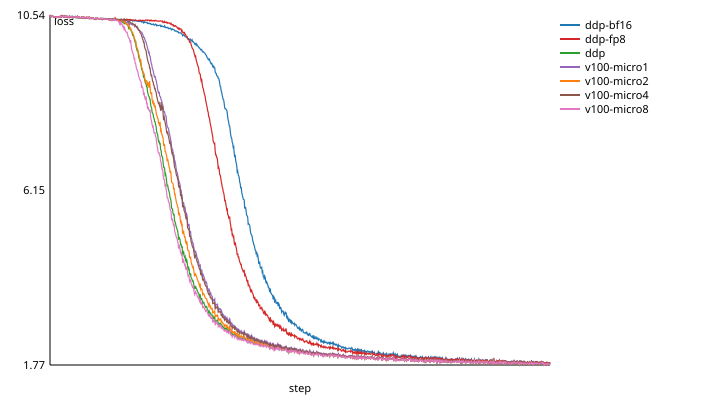

# Bridge compression

**Opt-in, changes results, not validated on GPUs.** On the first GPU run, a
V100, two of the kernel tests failed: the fp8 error-feedback residual
differed from the reference, from a codec overflow and a fused multiply-add,
both fixed in #50. Since then the kernels have matched the CPU reference on
NVIDIA V100, T4, A100, L40S and H200 GPUs and an AMD MI50 (the
[CHANGELOG](../CHANGELOG.md)'s runs). Compressed training has run on a V100
and an MI50: throughput in [BENCHMARKS.md](BENCHMARKS.md), loss curves in
[Training with compression](#training-with-compression).
[HARDWARE_VALIDATION.md](../HARDWARE_VALIDATION.md) items 28 and 29 list what
a GPU run must show.

```bash
export GPUBRIDGE_BRIDGE_COMPRESSION=fp8   # or bf16; unset (the default) is off
```

Every rank must set the same value. `init()` fails on every rank if they
differ or if one is invalid, as for the other settings.

## What it does

In a bridged all_reduce, island leaders send their island's sum across the
bridge: through host memory and Gloo (or UCX) between vendors, the slow hop.
Compression sends fewer bytes there, and only there. Island steps
(NCCL/RCCL over NVLink, Infinity Fabric or PCIe) stay in full precision.

- **What it applies to:** the bridge step of SUM and AVG reductions on
  floating-point tensors, in `all_reduce` and `reduce_scatter_tensor`, under
  the three bridged policies: `reduce-bridge-broadcast` (the default for two
  islands), `pipelined-reduce-bridge-broadcast` and `sharded-bridge`, and
  `auto-tuned` when it picks one of them.
- **What it leaves alone:** MAX and MIN, integer dtypes, broadcast and
  all_gather, the `native-only` and `flat-gloo` policies, and single-island
  jobs (no bridge). A mode also skips dtypes it wouldn't shrink: `bf16`
  compresses float32 and float64 only, while `fp8` also compresses float16
  and bfloat16.
- **Both bridge transports:** Gloo (the default) and UCX (`bridge="ucx"`).
  With UCX on a GPU leader the payloads go straight from GPU memory, with no
  host copy.

| mode | per value on the bridge | float32 bytes saved |
| --- | --- | --- |
| `bf16` | bfloat16, rounded to nearest even | 2x |
| `fp8` | OCP FP8 E4M3 code, plus one float32 scale per 256 values | 3.9x |

## How a compressed bridge step runs

On each bridge member (an island leader, or with `sharded-bridge` the rank
that owns a segment of a link):

1. **`compress`**: a Triton kernel adds this member's error-feedback residual
   (below) to its island sum and quantizes it into a byte payload, on the GPU,
   so the copy to host memory already carries fewer bytes.
2. **`bridge`**: every member broadcasts its payload in turn, so each ends up
   with every island's payload. Payloads are uint8 tensors, since Gloo has no
   fp8 dtype: fp8 travels as the block scales (float32 bytes) followed by the
   codes. The copies to and from host memory happen in this step, as they do
   uncompressed.
3. **`decompress`**: a second kernel dequantizes every payload and adds them
   in float32, in member order, then writes the result in the tensor's dtype.

The pipelined policy compresses the whole island sum once, exchanges the
payloads chunk by chunk (`GPUBRIDGE_CHUNK_BYTES` of payload per message,
copies overlapping the broadcasts as in its uncompressed pipeline), then
decompresses once. The sharded policy compresses each link's segment on its
own rank.

## Every rank still gets the same bits

Uncompressed, every rank ends a collective with the same bits. Compressed, it
still does. Leaders on different vendors run the kernels on different GPUs,
or one may use the PyTorch fallback, so this is by construction rather than by
luck:

- Every member dequantizes the *same* payloads, its own included (it never
  uses its own exact sum), and adds them in the same order.
- Scales are powers of two, and the scale exponent is capped at 119, so the
  largest code times its scale, 448 · 2^119, still fits in float32: every
  product of a code and its scale is exact. A fused multiply-add and a
  separate multiply then round the same way. The kernels are compiled without
  multiply-add contraction all the same (`enable_fp_fusion=False`), so no
  product is ever fused into an addition, and PyTorch's rounding on CPU is
  the kernels' too. Before the cap, a code that decoded beyond float32's range
  (256 · 2^120 = 2^128) left a residual of -inf on CPU and a finite one from a
  fused multiply-add on a GPU.
- fp8 codes and bfloat16 rounding are computed with integer arithmetic on
  float32 bit patterns, not with a GPU's fp8 instructions, which differ
  between vendors (NVIDIA's E4M3 against AMD's FNUZ variants on MI300).
- Magnitudes below 2^-100 count as zero, before quantizing and after every
  addition. So no value a kernel handles is a subnormal, and GPUs that flush
  subnormals to zero agree with those that don't.

The tests check this. The Triton kernels (in Triton's interpreter) and the
plain-PyTorch reference give the same bytes, residuals and results, NaN, ±inf
and tiny values included. In a simulated job with one leader on Triton and
the other on PyTorch, every rank still matches. The GPU kit records digests
of a fixed input on each GPU, so a mixed job's NVIDIA and AMD results can be
compared bit for bit.

## Error bounds

For one value v going into a quantization (the island sum plus the residual,
in float32), the value dequantized from its code differs from v by at most:

- **`bf16`:** 2^-8 |v|, half a bfloat16 unit in the last place.
- **`fp8`:** 2^-4 |v| + 2^-10 s, where s is its block's scale. s is the
  smallest power of two with max|v| / s <= 448 over the block, so
  s <= max|v| / 224, up to its cap of 2^119. The first term is E4M3's half
  unit (3 mantissa bits); the second covers values small enough to land in
  E4M3's subnormal range.
- **Beyond a mode's largest value:** `fp8` sends a value beyond 448 · 2^119
  (about 2.98e38, 87.5% of float32's maximum) as ±448 · 2^119, an error of up
  to 2^-3 |v|. `bf16` sends one that would round past bfloat16's largest
  (from about 3.3961e38) as that largest, 3.3895e38, within its bound above.
  The residual keeps the excess, but a value that stays that large is sent
  as the largest again next step: then what crosses falls short every step.
- **Either mode:** values below 2^-100 become 0.

The result's error, against the exact sum of the island sums, is the sum of
those bounds over the islands, plus float32 rounding while adding (at most
(islands - 1) * 2^-24 of the summed magnitudes), plus one rounding to the
output dtype. That holds while everything stays in range: not for a float64
value beyond float32's, nor for a sum that overflows float32 or an output
dtype (below). The tests check results against exactly this bound, and that
it isn't loose: one quantization of 4,096 values over many magnitudes comes
within 0.94 (`fp8`) and 0.97 (`bf16`) of it.

In practice: `bf16` keeps about three significant decimal digits per value;
`fp8` keeps about one, relative to the largest value in each block of 256.
Neither suits values that must add exactly, which is why integer dtypes, MAX
and MIN are never compressed.

**Non-finite values** stay non-finite, so AMP's overflow check still sees
them: NaN and ±inf become NaN in `fp8`, and stay themselves in `bf16`. Their
residual is 0, so one bad step doesn't poison the next. **Finite values stay
finite:** one beyond a mode's largest is sent as that largest (above), and a
finite float64 beyond float32's range, or a value its residual pushes past it,
counts as float32's largest. So every dequantized value and every residual
is a finite float32. Two things can still overflow, as uncompressed: adding
the islands' values in float32 (two at 1.7e38 round up to 2^127 each and sum
to inf, where the exact sum fits), and the result's dtype (a float16 value
near 65504 can be sent as 65536, inf in float16). Negative zero arrives as
zero.

## Error feedback

Each member keeps a float32 residual per buffer: what its last payload left
out of each value. It adds that to the next call's values before quantizing.
Summed over steps, what crossed the bridge is then the sum of the values
minus the last residual. So the accumulated error stays about one step's
bound instead of growing with the number of steps. The one exception is
saturation at float32's largest: once a value plus its residual passes it,
the part beyond is dropped, every step it does. The tests check that over
500 steps with the same values every step: without error feedback the error
ends 240 (`bf16`) to 325 (`fp8`) times larger.

- **Keyed by buffer.** A residual is found by its buffer's device, address,
  size and dtype (and segment, for `sharded-bridge`). Training loops and DDP
  reuse their gradient buffers, so the residual reaches the next step of the
  same data.
- **Reallocated buffers:** a new buffer at an old address with the same size
  would inherit an old residual. After reallocating gradient buffers, call
  `gpubridge.compression.reset_error_feedback()`. `destroy()` drops every
  residual.
- **Memory:** 4 bytes per value compressed, on bridge members only, held
  until `destroy()`.

## More than two islands

gpubridge makes one island per vendor, so real jobs have at most two today.
Tests relabel ranks to run three and four.

A ring all_reduce over compressed data would dequantize, add and quantize
again at every hop. Each hop adds a fresh quantization error, so with n
islands the last hop's sum carries up to n - 1 compounded roundings, and error
feedback can't correct the intermediate ones: each member only knows its own
residual.

gpubridge doesn't do that. **It accumulates in float32 and never quantizes
twice:** each island's sum is quantized once, its payload reaches every member
unchanged, and each member adds all of them in float32. The error is one
quantization per island, the bound above, however many islands there are.
This is also what lets every rank end with the same bits.

The cost is bandwidth: with n islands each member receives n - 1 payloads,
where an uncompressed ring would move about 2(n - 1)/n tensors. For float32,
`fp8` (payloads about a quarter of the tensor) still sends fewer bytes up to 7
islands, and `bf16` (half) up to 3; at 4 islands `bf16` breaks even. Every
real layout today has 2.

## Phases and observers

On a bridge member, a compressed all_reduce marks `compress`, `bridge` and
`decompress` as their own phases, between the island steps. Observers see
them in `CollectiveRecord.phases`, and `gpubridge.in_flight()` names them
while a thread is inside one. So the bridge phase stays the time spent moving
bytes, copies included as uncompressed, and kernel time is never mistaken for
a slow link. Non-members see only the island phases, as without compression.

## Kernels

`src/gpubridge/_compression_kernels.py` is one Triton source for CUDA and ROCm
builds. gpubridge imports it only when it compresses a GPU tensor. Without
Triton it warns once and runs the PyTorch reference on the GPU instead:
slower, same bits. `GPUBRIDGE_COMPRESSION_KERNELS=triton|torch` forces one
implementation, for testing. It is local: ranks may differ, since the results
don't. Every launch passes `LAUNCH_OPTIONS` (`enable_fp_fusion=False`): a CPU
test compiles each kernel for sm_70 and sm_90, without a GPU, and checks that
its PTX has no fused multiply-add.

- **quantize:** one program per block of 256 values. It reads the values and
  the residual, finds the block's largest finite magnitude and its scale,
  writes the codes, the scale and the new residual. It is a single pass over
  memory.
- **dequantize-accumulate:** one program per block. It reads that block's
  codes and scale from every member's payload, adds in float32 and writes
  the output.

## Kernel speed

### Measured

`bench_compression.py` at 1 GB, fusion off, as a share of the GPU's measured
device-to-device copy bandwidth (GB/s of the bytes each kernel must move, over
the copy's):

| GPU | copy bandwidth | commit | `bf16` mode, quantize and dequantize (float32) | `fp8` quantize float32 | `fp8` dequantize float32 | `fp8` quantize bfloat16 | `fp8` dequantize bfloat16 |
| --- | --- | --- | --- | --- | --- | --- | --- |
| NVIDIA V100 (sm_70) | 780 GB/s | df80abb | - | 101% | 81% | 99% | 52% |
| AMD MI50 (gfx906) | 775 GB/s | df80abb | 102 to 105% | 78% | 55% | 63% | 39% |
| NVIDIA H200 (sm_90) | 4,236 GB/s | df80abb | 97 to 99% | 72% | 40% | 61% | 24% |

The `bf16` mode keeps up with memory everywhere. The `fp8` kernels don't,
and not only on the fast GPU: the MI50 has the V100's bandwidth and is
compute-bound like the H200.

**Why: operations per byte.** The `bf16` mode does a few integer operations
per value; `fp8`'s integer-emulated E4M3 encode and decode do tens. What a GPU
can afford per byte is its issue rate over its bandwidth. Estimates, from
published SM and CU counts and boost clocks at one instruction per lane per
cycle, not measured:

| GPU | lane operations per second | per byte of copy bandwidth |
| --- | --- | --- |
| V100 | 80 SMs × 128 lanes × 1.53 GHz ≈ 15.7 T | ≈ 20 |
| MI50 | 60 CUs × 64 lanes × 1.725 GHz ≈ 6.6 T | ≈ 8.5 |
| H200 | 132 SMs × 128 lanes × 1.98 GHz ≈ 33.5 T | ≈ 7.9 |

The MI50 and the H200 can afford less than half the V100's operations per
byte. Dequantize to bfloat16 does the most per byte it moves: for each value
and member a decode, the scale multiply and the tiny-value test after each
addition, then integer bfloat16 rounding, all for about 4 bytes of traffic.
It is the slowest kernel on all three.

### The plan, in order (designed, not built)

Each step keeps every payload and result bit-identical to the CPU reference,
on every vendor. The reference stays as it is, as the specification: each
faster kernel path is shown equal to it, exhaustively where the inputs allow.

**1. A lookup table for the E4M3 decode (dequantize).**

- *What:* the 256 decoded values, float32, computed once on the host by the
  reference's own decode (`_decode_e4m3(arange(256))`), uploaded once per
  device (1 KB) and passed to the kernel. The decode becomes one gather,
  `table[code]`, then the scale multiply as now. Quantize's decode of its own
  codes, for the residual, uses it too.
- *Why first:* dequantize is the slowest kernel on every GPU measured, and the
  decode is most of its work per value. A table needs no vendor instruction,
  so it serves the V100, the MI50 and the H200 alike.
- *Bit-exact by construction:* each entry is the reference's decode of that
  code, bits and all: the two NaN codes (0x7F, 0xFF) hold the reference's NaN
  (0x7FC00000), 0x80 holds -0.0. Everything after the decode is unchanged (a
  multiply by a power of two, additions in member order, zeroing below
  2^-100), so the output is too.
- *How, in Triton:* a gather from the table in global memory (1 KB stays in
  L1), or the table loaded once per program and `tl.gather` from on-chip
  memory. Measure both: a warp's 32 lookups can hit 32 different words, and
  how well each GPU's L1 or LDS serves that decides between them.
- *Plan B,* if the gather is slower than the arithmetic: build the float32
  bits directly. Normal codes are `sign << 31 | (exp + 120) << 23 | mant <<
  20`, subnormal codes (exp 0) are `mant × 2^-9`, NaN by a select: about half
  today's operations, checked against the reference on all 256 codes.
- *Tests:*
  - CPU: the table equals the reference decode on all 256 codes, bit for bit,
    NaN bits included;
  - the interpreter tests against the reference, every mode, output dtype,
    member count and size, unchanged;
  - GPU: `test_gpu_dequantize_accumulate_matches_the_cpu_reference` on each
    GPU, and the fixed-input digests unchanged from before the change;
  - the bench, before and after, on a V100, an MI50 and an H200.

**2. A cheaper integer encode (quantize).**

- *What:* today's encode computes both the normal and the subnormal E4M3 path
  for every value and selects one (roughly 28 operations, an estimate).
  Instead, with |q| clamped at 448 first and the sign or'ed in as now (about
  13 operations):
  - normal codes (|q| >= 2^-6): `((bits + 0x7FFFF + ((bits >> 20) & 1)) >> 20)
    - (120 << 3)`, which rounds the mantissa to 3 bits, half to even, by
    adding a bias; a carry into the exponent is the next binade's code, as it
    should be;
  - subnormal codes (|q| < 2^-6): the bits of `|q| + 2^14` less those of
    `2^14`. One float32 addition rounds |q| to a multiple of 2^-9 (round to
    nearest even), and the low bits of the sum are that multiple, 0 to 8 (8
    is the smallest normal code, 0x08).
- *Bit-exact:* both are round-to-nearest-even onto the reference's grid.
  Checked exhaustively on CPU against `_encode_e4m3`: every float32 with
  |x| <= 512, both signs (2,281,701,378 values), all equal, in 27 s on six
  cores. The float32 addition is correctly rounded on every GPU, and a
  float32 subnormal |q| rounds to 0 whether or not the GPU flushes it, so
  flushing can't change a code.
- *Tests:* that exhaustive equivalence in CPU CI (or a strided subset there
  and the full sweep on demand, if 27 s is too much); the interpreter and GPU
  tests against the reference; the digests unchanged; the bench.

**3. A hardware fp8 path for sm_89 and later (last).**

- *What:* on NVIDIA GPUs of compute capability 8.9 or later (L40S, H100,
  H200, Blackwell), `cvt.rn.satfinite.e4m3x2.f32` for the encode, two values
  per instruction, and `cvt.rn.f16x2.e4m3x2` then `cvt.f32.f16` for the decode
  where that beats the table.
  - **Selection:** at launch, from the device's capability, as a constexpr, so
    each path compiles on its own.
  - **Where the integer path stays:** sm_70, sm_75, sm_80, and every AMD GPU.
    MI300's fp8 instructions implement the FNUZ variant, a different format.
  - **An override:** a local setting forces either path, for tests and
    benchmarks, as `GPUBRIDGE_COMPRESSION_KERNELS` does. Ranks may differ,
    since the bits don't.
- *Bit-exact:* the instruction only ever rounds what the reference rounds.
  - Its inputs are finite, non-negative and at most 448. The shared code
    clamps |q| at 448, takes the sign from `q < 0`, and selects 0x7F for
    values that aren't finite, as now. q is never -0, because v's zeros are
    +0. So the saturation and NaN rules of `.satfinite` never apply, and
    neither does the sign of a zero.
  - On [0, 448] it rounds to nearest even onto the E4M3 grid: subnormals in
    steps of 2^-9, at most 448. That is the reference's grid and rule. A
    float32 subnormal input rounds to +0 either way, so whether the hardware
    flushes inputs can't matter.
  - Decode: every E4M3 value is exact in float16 and float32. The NaN codes
    are selected to the reference's NaN explicitly. So every code decodes to
    the reference's bits.
- **Not Triton's own cast on sm_89.** Triton 3.8 compiles `x.to(tl.float8e4nv,
  fp_downcast_rounding="rtne")` to `cvt.rn.satfinite.e4m3x2.f32` on sm_90 and
  sm_100. On sm_89 it compiles it to `cvt.rz.f16.f32` then
  `cvt.rn.satfinite.e4m3x2.f16x2`: a truncation to float16, then the rounding.
  - **How often it differs:** emulated on CPU over every float32 in
    [2^-14, 448], that double rounding differs from the reference for 516,033
    of 190,840,833 values (0.27%).
  - **An example:** 0x3A800001, just above 2^-10, encodes to 0x01 directly and
    to 0x00 through float16.
  - **So:** the encode uses inline PTX for that one instruction on every
    sm_89+ target, or the path starts at sm_90.
- *Tests:*
  - CPU, offline PTX, as for fused multiply-adds:
    - the hardware variant for sm_89, sm_90 and sm_100 contains
      `cvt.rn.satfinite.e4m3x2.f32` and no `cvt.rz.f16.f32`;
    - the integer variant for sm_80 has no fp8 conversion;
    - dispatch by capability, and the override.
  - GPU, on an sm_89 (L40S) and an sm_90 (H200) GPU, both on Explorer:
    - the hardware encode against the integer encode on every float32 with
      |x| <= 512, both signs (2.28e9 values, seconds on a GPU);
    - all 256 codes through both decodes;
    - the existing GPU tests on the hardware path;
    - the fixed-input digests equal to the integer path's on the same GPU,
      and to the other vendors';
    - the bench.
- *Possibly also:* bfloat16 output by `cvt.rn.bf16.f32` (sm_80 and later),
  with an explicit NaN select. It is identical to the integer rounding, since
  the float32 sum is never subnormal (zeroed below 2^-100) and overflow to
  inf rounds the same way. That is what remains of dequantize-to-bfloat16's
  cost after step 1.

**Before step 1:** one Nsight Compute run of the two `fp8` kernels on the
H200, and `rocprofv3` on the MI50 if counters are available. They show where
dequantize stalls: on instruction issue, which steps 1 and 2 cut, or on
memory latency and occupancy, where more values per thread or wider loads
would help more.

## Measuring it

- `scripts/gpu/bench_compression.py` times both kernels per mode, dtype and
  size, in GB/s of the bytes they must move, against the GPU's memory
  bandwidth (a measured device-to-device copy, and the peak where PyTorch
  reports the memory clock and bus width). It also checks the GPU's kernels
  against the CPU reference and records the digests. `--fp-fusion` launches
  the kernels with multiply-add contraction on: one run each way times what
  gpubridge's default (off) costs.
- `scripts/gpu/bench_all_reduce.py --compression none,bf16,fp8 --phases` times
  the active policy with each mode in one job, with the compress, bridge and
  decompress times. For one random tensor per size it records the error
  against the uncompressed result and whether every rank matched. summary.md
  says from which size each mode is faster than uncompressed.
- The GPU kit runs both (steps `bench_compression_kernels` and
  `bench_compressed` in `amd/run_all.sh`, Explorer steps 04 and 07, and the
  two-machine `mixed/node.sh`). The first GPU run shows where compression
  starts paying off.

## Training with compression

DDP through `gpubridge.ddp_comm_hook` on a V100 and an MI50, uncompressed,
`bf16` and `fp8` on the bridge (Triton kernels on both GPUs), against one V100
alone: `train_dp.py` on `llama-125m`, a global batch of 8 sequences x 512
tokens (4 per GPU), AdamW 3e-4, seed 0, 1,000 steps. The setup and the
throughput are in [BENCHMARKS.md](BENCHMARKS.md#data-parallel-training-on-a-llama-style-model).
The V100 baselines put the same batch through in 1, 2, 4 or 8 micro-batches:
the same mean gradient, summed in another order. Explorer jobs 11111481 (DDP)
and 11109239, 11109665, 11109872 and 11110316 (the V100).

| Run | Loss at step 1,000 | Mean of the last 100 steps | Mean gap to the four V100 runs, last 100 steps | Loss first below 9 at step |
| --- | ---: | ---: | ---: | ---: |
| V100 alone, 1, 2, 4 and 8 micro-batches | 1.800 to 1.809 | 1.807 to 1.812 | 0.0041 to 0.0056 between them | 179 to 210 |
| V100 + MI50, uncompressed | 1.802 | 1.806 | 0.0037 to 0.0067 | 188 |
| V100 + MI50, `bf16` | 1.830 | 1.838 | 0.0263 to 0.0312 | 337 |
| V100 + MI50, `fp8` | 1.831 | 1.834 | 0.0217 to 0.0266 | 302 |



**Why not compare the curves step by step.** Every run sits on a plateau near
ln(32000) = 10.37, the loss of a uniform guess over the vocabulary, then falls
to about 2 over the next 200 or so steps. When the drop starts depends on float rounding. Two
runs of the same one-V100 job match for 4 steps, then differ by 1e-7 at step
5, 1e-3 by step 24 and 0.1 by step 157 (jobs 11107533 and 11109239). One of
them was still at 8.24 at step 500, the other at 2.10. So after 500 steps
the curves of identical runs can be far apart, and only once every run has
dropped do they come back together. Hence 1,000 steps and the last 100.

**The tolerance.** Runs that differ only in rounding and drop at about the
same time end 0.004 to 0.007 apart: the four V100 runs, uncompressed DDP, and
an uncompressed 1F1B pipeline on the same two GPUs (gpubridge #81: 0.0036 to
0.0052). An uncompressed GPipe pipeline that dropped 130 to 160 steps later
(step 341) ends 0.020 to 0.025 above them. Both compressed runs dropped later
too and end 0.022 to 0.031 above: about the gap rounding alone leaves after a
late drop. So, after 1,000 steps, compressed DDP is within about 0.03 of one
V100 on this model, and nothing in these runs separates compression's error from
the timing of the drop. The ranks' parameters were bit-identical at every
check, every 50 steps, compressed or not.

**Open: does compression delay the drop?** In all four compressed runs so far
the drop came later than in the uncompressed DDP run of the same job: bf16 at
steps 228 and 337, fp8 at 302 and 457, against 190 and 188 (job 11105619, 500
steps with the PyTorch kernels on the MI50, and job 11111481).
Fourteen uncompressed runs, on one GPU or two, dropped between steps 172 and
444. Several seeds per setting would tell a delay from chance.

## Not done

- The `fp8` kernels are compute-bound on the MI50 and the H200 ([Kernel
  speed](#kernel-speed)): a plan, not built.
- Where compression pays off in a real job, the cost of compiling without
  fused multiply-adds, and a mixed job's digests across vendors are open
  (items 28 and 29).
- Whether compression delays the drop off the loss plateau ([Training with
  compression](#training-with-compression)): several seeds per setting.
- Compressed broadcast, all_gather, or a compressed island step.
