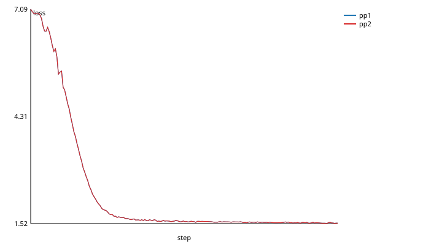

# Megatron-Core's pipeline across vendors

**Status: experimental; runs on a V100 and an MI50.** Megatron-Core's own
pipeline parallelism, with one stage on an NVIDIA GPU and one on an AMD GPU,
through `backend="gpubridge"`. Nothing in Megatron is patched. This page lists
what that takes and what isn't tried across vendors. Results:
[below](#results-a-v100-and-an-mi50).

## How it fits together

Zettabyte's paper (Hu et al., [arXiv 2602.18007](https://arxiv.org/abs/2602.18007))
modified Megatron-LM: TP=1, PP=2, data parallel within each vendor, with
heterogeneity "only in the PP groups" (§4.1). gpubridge gets the same shape from
configuration alone:

- **Process groups.** `torch.distributed` starts with `backend="gpubridge"`.
  Megatron's `parallel_state.initialize_model_parallel` then creates its groups
  with `new_group` on that default backend, so each group is a gpubridge
  group: native NCCL or RCCL within a vendor, the bridge across vendors.
  Tensor-parallel and data-parallel groups that stay within one vendor never
  touch the bridge.
- **Pipeline sends.** Megatron's schedules move activations and gradients with
  `batch_isend_irecv` (or `isend`/`irecv`) on the pipeline group. gpubridge's
  point-to-point runs them natively within an island and host-staged across
  the bridge ([TORCH_BACKEND.md](TORCH_BACKEND.md#point-to-point-cpu-only)).

[`scripts/gpu/megatron_pp.py`](../scripts/gpu/megatron_pp.py) is the
integration: Megatron-Core's `GPTModel`, its `get_forward_backward_func`
schedule (1F1B with more than one stage) and a plain AdamW per stage. The
configuration avoids what doesn't run on both vendors:

| Megatron feature | Here | Why |
| --- | --- | --- |
| Transformer Engine layers and FP8 | off: the local layer spec (`get_gpt_layer_local_spec`) | NVIDIA-only |
| Apex fused kernels (layer norm, Adam, gradient accumulation fusion) | off: Megatron falls back to PyTorch's own | Apex isn't installed in these venvs; not tried |
| Fused bias-activation, bias-dropout, softmax and rope kernels | off (Megatron-Core 0.14's defaults) | not tried across vendors |
| bf16 | off: float32 | the V100 has no bf16 |
| Dropout | off | so runs on different GPUs can be compared |
| Tied input and output embeddings | off (`share_embeddings_and_output_weights=False`) | tying them across pipeline stages adds an all-reduce between the first and last stage, across the bridge; not tried |
| Interleaved (virtual) pipeline stages, tensor, sequence, context and expert parallelism, the distributed optimizer | not used | not tried across vendors |

**Weights.** Every rank builds the whole model on the CPU from the seed,
with Megatron set to one pipeline stage, and each stage then keeps its
layers' weights. So a two-stage run starts from exactly the weights of the
one-GPU run it's compared with.

**Data.** Synthetic tokens from `llama.py`'s rule, `(prev * 7 + 13 + e) %
vocab` with `e` uniform in 0..3, with a 1,024-token vocabulary, so the loss
falls within the run's 200 steps.

**Megatron-Core version.** 0.14.0, from its wheel unpacked into a directory
of its own (`MEGATRON_PATH`), on torch 2.9.1 on both sides. 0.19 imports
Triton at load time (its MoE code); 0.12 to 0.14 don't.

**No CPU test.** Megatron-Core's pipeline code calls CUDA directly: its
receive buffers go on `torch.cuda.current_device()`, it calls `.cuda()` and
`torch.cuda.synchronize()`, and builds the causal mask on `"cuda"`. What does
run on CPU is Megatron's group setup on `backend="gpubridge"` and a
`batch_isend_irecv` across its pipeline group, both checked by hand.

## How to run

```bash
# Megatron-Core's wheel, unpacked (no Python on the login node):
cd $WORK_DIR && unzip megatron_core-0.14.0-cp312-cp312-manylinux_2_24_x86_64.manylinux_2_28_x86_64.whl \
    -d megatron-core-0.14.0
# One stage on the V100 (the baseline), then two across the V100 and the MI50:
VENV=$WORK_DIR/venv-cu291 VENV_ROCM=$WORK_DIR/venv-rocm63 STEPS_07=megatron \
    MEGATRON_PATH=$WORK_DIR/megatron-core-0.14.0 TIME_07=00:40:00 \
    scripts/gpu/explorer/submit.sh 07
python scripts/gpu/dp_report.py results/explorer/07_mixed_hetjob_megatron \
    --baseline pp1 --out results/explorer/megatron-report
```

`MEGATRON_STEPS` sets the steps (200) and `MEGATRON_ARGS` passes more options
to both runs (`--layers`, `--hidden`, `--heads`, `--vocab`, `--seq-len`,
`--micro-batch`, `--microbatches`).

## Results: a V100 and an MI50

Explorer job 11117506, commit bc266c6 (clean on both ranks), Megatron-Core 0.14.0:
- the V100 on torch 2.9.1+cu126, the MI50 on 2.9.1+rocm6.3;
- a GPT of 12 layers, width 768, 12 heads, a 1,024-token vocabulary;
- sequences of 512 tokens, 4 microbatches of 2 a step, AdamW 3e-4, seed 0, 200
  steps, float32;
- the bridge over TCP on `internal.2137` (preflight: 1152 to 1174 MB/s each
  way).

The baseline ran in the same job: Megatron with one pipeline stage, on the V100
alone. Medians of steps 6 to 200.

| Run | Layers | Tokens/s | Step (ms) | Loss, step 1 | Loss, step 200 |
| --- | --- | ---: | ---: | ---: | ---: |
| V100 alone, one stage | 0 to 11 | 14,990 | 273.3 | 7.0886 | 1.5359 |
| V100 + MI50, two stages, 1F1B | 0 to 5 on the V100, 6 to 11 on the MI50 | 17,057 | 240.1 | 7.0886 | 1.5359 |



- **It runs, with Megatron's own schedule and no patch.** Megatron's groups,
  its `batch_isend_irecv` between the stages and its 1F1B schedule all ran
  through `backend="gpubridge"`.
- **The two curves match.** They're identical to 1e-6 for the first 7 steps,
  and at most 1.3e-4 apart over the 200 (at step 21; 7e-7 on average over the last 50). The same weights at the start
  and the same data, summed in another order on other GPUs.
- **The pair is 1.14x the V100 alone** (17,057 against 14,990 tokens/s).
  Its output layer is small (768 x 1,024), so an even split of the layers
  leaves the two stages' work closer to equal than with the kit's
  32,000-token model ([PIPELINE.md](PIPELINE.md)).
- **The first try had two bugs, both mine.**
  - Each stage built all 12 layers: Megatron-Core 0.14 sizes a stage from the
    config's `pipeline_model_parallel_size`, not only from its process groups.
    `megatron_pp.py` now sets it, and stops if the stages don't hold each layer
    exactly once.
  - The record held each step's loss divided by the 4 microbatches: Megatron
    divides the returned loss in place, and the record shared its memory. It
    now copies it.
- **Not tried:** more than two stages, data parallelism within each vendor
  (Zettabyte's DP=8 per side needs several GPUs per vendor, which Explorer's
  `gpu` and `sharing` partitions don't give one job), and the rest of the
  table above.
