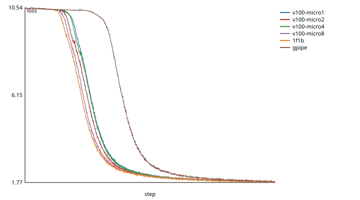

# Pipeline training across vendors

**Status: trains on a V100 and an MI50 on Explorer**, GPipe and 1F1B, 1,000
steps each ([results](#results-a-v100-and-an-mi50)); bit for bit like plain
Gloo on CPU.

A model's layers cut into stages on GPUs of different vendors: stage 0 on an
NVIDIA GPU, stage 1 on an AMD one, the activations going forward and their
gradients back between them through gpubridge. [`train_pipeline.py`](../scripts/gpu/train_pipeline.py)
does it with PyTorch's own pipelining (`torch.distributed.pipelining`) on a
plain `backend="gpubridge"` process group; nothing in gpubridge is specific to
pipelines.

## Design

**The model.** [`llama.py`](../scripts/gpu/llama.py): a LLaMA-style decoder
(RMSNorm, rotary embeddings, grouped-query attention, SwiGLU, untied output
layer), `llama-125m` (134M parameters) to `llama-1b` (1.03B), sized so a stage
of it, or the whole model with float32 AdamW state, fits a 32 GB V100 or MI50.
Every rank builds the whole model from one seed on the CPU, keeps its stage
and drops the rest, so every stage starts from the same weights as one GPU
would. Synthetic tokens follow a fixed rule with a little noise
(`llama.global_batch`), so the loss falls and two curves can be compared; a
small real dataset isn't wired in yet.

**Stages.** Stage *i* holds a contiguous range of the blocks; stage 0 also the
embedding, the last stage the final norm and output layer. The split is even
by default; `--split 7,5` sets it by hand, in stage order, and `--split auto`
balances it ([Automatic stage balancing](#automatic-stage-balancing)). Stages go to the NVIDIA ranks first, then the AMD ones, each in rank
order, whatever ranks the launcher handed out (torch's c10d rendezvous doesn't
promise the NVIDIA node rank 0), and the pipeline's neighbours follow that
order; the record lists each stage's rank, vendor and blocks.

**Communication.** `PipelineStage` sends each microbatch's activations to the
next stage and receives its gradient back with `dist.isend`/`irecv` on the
default group. On `backend="gpubridge"` these are the backend's point-to-point
operations ([TORCH_BACKEND.md](TORCH_BACKEND.md#point-to-point)):
native NCCL/RCCL within an island, host-staged across the bridge between
islands, bit-exact either way. The stages' tensor shapes are given up front
(static mode), so torch infers nothing over the network; the activations that
cross a stage boundary are marked as needing gradients, which is how torch
knows to send their gradients back.

**Every rank on one PyTorch release.** `torch.distributed.pipelining`'s
schedules open with a handshake between neighbouring stages, and it isn't the
same in every release: 2.14.1's first messages don't match 2.9.1's. So
`train_pipeline.py` stops before building the stages if the ranks' releases
differ. 2.9's handshake also sends each stage's index as an int64 into the
neighbour's float32 buffer; NCCL moves the bytes regardless, but gpubridge's
point-to-point (and Gloo) refuse a payload that isn't the receiver's size and
dtype, so `train_pipeline.py` has 2.9 send a float32, as 2.14.1 does. The CPU
tests pass on 2.8.0, 2.9.1 and 2.14.1.

**Schedules.** GPipe (`--schedule gpipe`: every microbatch forward, then every
backward) and 1F1B (`1f1b`: one forward, one backward, alternating once the
pipeline is full), with `--microbatches` microbatches of the global batch per
step and the gradients averaged over them.

**What is recorded.** Each step's loss (the mean of the microbatches' losses
on the last stage) and time (the slowest stage's); tokens/s from the median
step; per stage its blocks, the forward and backward of one microbatch through
it alone, and the time one microbatch's activations take to arrive from the
previous stage, each pair of neighbouring stages timed on its own. From those, two estimates: each stage's idle time per step (the
step less its microbatches' compute) and GPipe's ideal bubble share,
(stages − 1) / (microbatches + stages − 1). The baseline is
[`train_dp.py`](../scripts/gpu/train_dp.py) `--mode single` on one GPU, with the
same model, global batch, seed and `--micro` equal to the microbatches, so the
two compute the same mean gradient each step.

## How to run

On CPU, two simulated islands:

```bash
GPUBRIDGE_VENDOR=nvidia GPUBRIDGE_SPLIT_TEST=half torchrun --nproc-per-node=2 \
    scripts/gpu/train_pipeline.py --model llama-tiny --steps 20 --json /tmp/pp.json
```

On Explorer, a V100 (stage 0) and an MI50 (stage 1) in one heterogeneous job,
with the MI50 on the `venv-rocm63` venv (torch 2.9.1, the build whose rocBLAS
has gfx906 kernels) and the V100 on a CUDA venv of the same release, and the
single-V100 baseline:

```bash
export VENV_ROCM=$WORK_DIR/venv-rocm63
VENV=$WORK_DIR/venv-cu291 TORCH_VERSION=2.9.1 scripts/gpu/explorer/submit.sh setup   # once
VENV=$WORK_DIR/venv-cu291 STEPS_07=pipeline DP_STEPS=1000 TIME_07=00:55:00 \
    scripts/gpu/explorer/submit.sh 07                                     # gpipe, then 1f1b
DP_STEPS=1000 DP_MICRO=4 scripts/gpu/explorer/submit.sh dp-baseline
python scripts/gpu/dp_report.py results/explorer/07_mixed_hetjob_pp \
    results/explorer/dp_baseline_nvidia --out results/explorer/pp-report
```

`PP_RUNS` picks the schedules, `PP_MICROBATCHES` the microbatches (4), `PP_ARGS`
more options for every run (`--split 7,5`); `DP_MODEL`, `DP_STEPS`,
`DP_GLOBAL_BATCH` and `DP_SEQ` the model and run (llama-125m, 500 steps, 8
sequences of 512 tokens), shared with the data-parallel runs and the baseline.
`dp_report.py` puts the runs against the baseline: tokens/s, the loss curves'
largest gap and the gap over the last 100 steps, and the curves as CSV and SVG.

## Results: a V100 and an MI50

Explorer job 11109376, commit dc47b6a (clean on both ranks): stage 0 on a V100
(torch 2.9.1+cu126), stage 1 on an MI50 (2.9.1+rocm6.3), point-to-point
through `backend="gpubridge"`, host-staged over TCP on `internal.2137`
(preflight: 1164 to 1174 MB/s each way, 0.12 to 0.13 ms round trip). `llama-125m`, an
even split of 6 + 6 blocks (67.05M parameters each; stage 0 also has the
embedding, stage 1 the final norm and output layer), 4 microbatches of 2
sequences x 512 tokens a step, AdamW 3e-4, seed 0, 1,000 steps. The baselines
are `train_dp.py --mode single` on one V100 (2.14.1+cu126; jobs 11109239,
11109665, 11109872 and 11110316), the same model, data and seed, with the
global batch in 1, 2, 4 or 8 micro-batches: the same mean gradient, summed in
a different order. Medians of steps 6 to 1,000.

| Run | Tokens/s | Step (ms) | Against one V100, 4 micro-batches | Loss at step 1,000 | Mean gap to the V100 runs, last 100 steps |
| --- | ---: | ---: | ---: | ---: | ---: |
| V100 alone, 1 micro-batch | 14,264 | 287.1 | 1.14x | 1.809 | 0.0044 to 0.0056 |
| V100 alone, 2 micro-batches | 13,518 | 303.0 | 1.08x | 1.802 | 0.0041 to 0.0047 |
| V100 alone, 4 micro-batches | 12,548 | 326.4 | 1.00x | 1.806 | 0.0042 to 0.0046 |
| V100 alone, 8 micro-batches | 10,841 | 377.8 | 0.86x | 1.800 | 0.0041 to 0.0056 |
| V100 + MI50, GPipe | 13,115 | 312.3 | 1.05x | 1.823 | 0.0203 to 0.0251 |
| V100 + MI50, 1F1B | 13,051 | 313.8 | 1.04x | 1.801 | 0.0036 to 0.0052 |

Per stage, from the same runs (GPipe; 1F1B's within 1.5 ms of each):

| Stage | GPU | Blocks | Forward + backward of one microbatch, alone (ms) | Idle per step (est., ms) | One microbatch's activations arriving (ms) |
| --- | --- | --- | ---: | ---: | ---: |
| 0 | V100 | 0 to 5, and the embedding | 37.0 | 164.5 | - |
| 1 | MI50 | 6 to 11, and the output layer | 61.8 | 65.2 | 8.0 |



- **The pair is about as fast as the V100 alone, not faster.** It's 1.05x the
  V100 running the same 4 micro-batches (the run that computes the same
  gradient) and 0.92x the V100 with the batch in one piece. Each hop carries
  one microbatch's activations, 3 MB, against the 536 MB of gradients that
  data parallelism sends over the same link each step, where DDP reaches
  0.32x the V100 alone ([BENCHMARKS.md](BENCHMARKS.md#data-parallel-training-on-a-llama-style-model)).
- **The MI50's stage is the slow one**: 61.8 ms a microbatch against the
  V100's 37.0, so the V100 idles about 164 ms of each 312 ms step. Not all of
  that is the GPU: both stages have 6 blocks, but stage 1 also runs the output
  layer (768 x 32,000) and the loss. The step is close to what GPipe's schedule predicts from the
  slowest stage, (microbatches + stages - 1) x 61.8 = 309 ms (an estimate, not
  a measurement). Uneven splits are faster: 9 + 3 reached 16,021 tokens/s in a
  later job ([Automatic stage balancing](#measured-a-v100-and-an-mi50)).
- **1F1B tracks the one-V100 runs as closely as they track each other**: over
  the last 100 steps it's 0.0036 to 0.0052 from each, and they're 0.0041 to
  0.0056 apart.
- **GPipe ends 0.02 above them, and it left the plateau later.** Every run
  sits on a plateau near ln(32000) = 10.37 before dropping. GPipe's loss
  first fell below 9 at step 341, the other five runs' between steps 172 and
  210. When the drop starts varies from run to run: a 500-step one-V100 run
  with the same settings as `micro 1` above was still at 8.2 at step 500
  (job 11107533), and it and the `micro 1` run above differ by more than 0.1
  from step 158. Whether GPipe's gap comes from its late drop or from its
  schedule, one run can't tell; several seeds would.
- 500 steps, which the prompt asked for, end in the middle of the drop for
  some runs, where the curves can't be compared, hence 1,000.
- The first try failed in torch's stage setup, for the two reasons in
  [Design](#design): first 2.14.1 on the V100 against 2.9.1 on the MI50, then
  2.9.1's int64 handshake.

## Automatic stage balancing

GPUs of different speed want different shares of the layers. `--split auto`
picks the split from measurements, with [`gpubridge.balance`](../src/gpubridge/balance.py),
an opt-in module that nothing else imports:

1. **Profile.** Every rank runs each layer (the embedding, each block, the
   final norm and output layer) forward and backward on its own GPU, one
   microbatch, timed with CUDA or HIP events after a warmup
   (`balance.profile_layers`). It also records each layer's output size (what
   crosses a stage boundary after it), its state (parameters, gradients and
   AdamW's two moments: 16 bytes a parameter) and the tensors autograd saves
   for its backward. The embedding's cost goes with the first block, the
   output layer's with the last, as they always share those blocks' stages.
2. **Time the links.** Each pair of neighbouring stages sends one microbatch's
   activations, timed alone, as the record's hop times are.
3. **Partition** (`balance.partition`): of every split into contiguous ranges,
   at least one block each, the one whose slowest stage is fastest. A stage's
   time per microbatch is its blocks' forward and backward on its own GPU,
   plus `2 x activation bytes / link bandwidth` at each boundary it shares
   (forward the activation, back its gradient; both sides count it, as the
   host-staged send and receive keep both waiting). A stage's memory is its
   blocks' state plus their saved activations times the microbatches it holds
   at once (all of them with GPipe, `stages - stage` with 1F1B), within 90% of
   its GPU's memory. Exact, by dynamic programming over the boundaries; the
   tests check it against brute force on random cases with injected speeds,
   links and memory limits.

Every rank computes the same split from the gathered measurements. The record
keeps them: each stage's per-block times, the links, the memory limits, the
predicted stage times for the chosen split and for the even one, and the
speedup the cost model predicts.

**When it helps:** stages on GPUs of different speed, or a model whose layers
cost different amounts (here the output layer, 768 x 32,000, sits on the last
stage). **When it doesn't:** identical GPUs and identical layers, where the
even split is already best; and whatever the model leaves out: the pipeline's
fill and drain (the same for every split with the same stages and
microbatches), transfers overlapping compute, and the optimizer step. A split
it predicts faster can still measure slower, which is why step 07 runs it next
to the even and hand-tuned splits.

**Prior work.** Zettabyte's paper (Hu et al.,
[arXiv 2602.18007](https://arxiv.org/abs/2602.18007), §3.1.2 and §4.2) split
the layers by hand: for LLaMA-8B, 15 on the AMD stage and 17 on the NVIDIA one,
fewer on AMD "due to their lower observed throughput". It doesn't say how it
chose those counts.

```bash
# Even, three hand-tuned splits and the automatic one, 1F1B, in one job:
VENV=$WORK_DIR/venv-cu291 STEPS_07=pipeline PP_RUNS=1f1b PP_SPLITS="even 7,5 8,4 9,3 auto" \
    TIME_07=00:55:00 scripts/gpu/explorer/submit.sh 07
```

`PP_SPLITS` runs each schedule once per split, as `pp_<schedule>_<split>`
(step and record).

### Measured: a V100 and an MI50

Explorer job 11113912, commit 8217a36 (clean on both ranks), both GPUs on torch
2.9.1: `llama-125m`, 1F1B, 4 microbatches of 2 x 512 tokens, 500 steps, every
split in the one job (preflight: 1163 to 1174 MB/s each way). Medians of steps
6 to 500; compute is one microbatch's forward and backward through the stage
alone.

| Split (V100 + MI50 blocks) | Tokens/s | Against even | Step (ms) | V100 compute | MI50 compute | V100 idle (est.) | MI50 idle (est.) |
| --- | ---: | ---: | ---: | ---: | ---: | ---: | ---: |
| even, 6 + 6 | 13,062 | 1.00x | 313.6 | 36.8 | 61.7 | 166.3 | 66.7 |
| 7 + 5 | 14,216 | 1.09x | 288.1 | 42.7 | 54.5 | 117.2 | 70.2 |
| 8 + 4 | 15,577 | 1.19x | 263.0 | 47.1 | 46.7 | 74.4 | 76.1 |
| 9 + 3 | 16,021 | 1.23x | 255.7 | 50.3 | 39.0 | 54.4 | 99.5 |
| `auto`, which chose 8 + 4 | 15,559 | 1.19x | 263.3 | 43.2 | 46.8 | 90.4 | 75.9 |

- **The automatic split beats the even one by 1.19x, but not the best
  hand-tuned split.** It chose 8 + 4, which ran within 0.1% of the same split
  given by hand. 9 + 3 gave 3.0% more tokens/s. The cost model predicted 1.25x
  over even: 61.1 and 60.5 ms a microbatch for 8 + 4's stages, against 49.7 and
  76.3 for even's.
- **What the model misses.** By compute alone 8 + 4 is balanced (47.1 and
  46.7 ms) and 9 + 3 isn't (50.3 and 39.0), yet 9 + 3 was faster. Moving a block
  off the MI50 still shortened the step after the V100's compute passed the
  MI50's. So the MI50's stage seems to cost more per microbatch than its
  compute, by about the 11 ms gap at 9 + 3 or more, and the profile doesn't see
  it. Where it goes (host staging on that side, the bridge's receive, the last
  stage's loss) isn't measured yet. The model also charges each hop to both
  stages, while gpubridge's sends across islands don't block the sender, so it
  overstates the transfers. Timing each side's share of a hop would be the
  next step.
- **Compute alone varies between runs**: 8 blocks on the V100 took 47.1 ms in
  one run and 43.2 in the other. Close splits can swap places on that.
- **These runs compare throughput, not loss.** The even split's loss was
  still on the plateau at step 500 (9.42); the others had dropped (2.05 to
  2.08). As [above](#results-a-v100-and-an-mi50), the drop's timing varies from
  run to run.

Against Zettabyte's hand-chosen splits, then: on this pair, choosing the split
from measurements got within 3% of the best of three hand-tuned splits on its
first try, and didn't beat it.

## What's validated where

| What | Where | Status |
| --- | --- | --- |
| The pipeline through gpubridge gives the same losses as on a plain Gloo group, bit for bit | CPU, 2 stages (one per island), GPipe and 1F1B; 4 stages over 2 + 2 islands (hops within and across islands) | passes (`tests/test_gpu_kit.py`) |
| It tracks one process with the same global batch and microbatches | CPU, 4 stages, 8 steps: within 1e-4 | passes |
| Stages follow the stage order, not the ranks | CPU, stage 0 on rank 1: the same losses as stage 0 on rank 0, bit for bit | passes |
| The step 07 runs and their records | the fake cluster | passes (`tests/test_gpu_jobs.py`) |
| Loss curves, tokens/s, per-stage compute, idle time and hop time on a V100 + MI50 | Explorer, `STEPS_07=pipeline`, 1,000 steps | ran: 1F1B within the one-V100 runs' spread, GPipe 0.02 above it ([results](#results-a-v100-and-an-mi50)) |
| The automatic split is the best under the cost model | CPU: random cases with injected device speeds, links and memory limits, against brute force | passes (`tests/test_balance.py`) |
| `--split auto` trains like the same split given by hand | CPU, 2 stages | bit for bit (`tests/test_gpu_kit.py`) |
| Even, hand-tuned and automatic splits on a V100 + MI50, 500 steps | Explorer, `PP_SPLITS` | ran: automatic 1.19x even, 3.0% below the best hand-tuned ([above](#measured-a-v100-and-an-mi50)) |
| A two-stage pipeline on one V100, as a second baseline | - | not built |

A number in this file gets written only once it was measured, with where it
ran.
